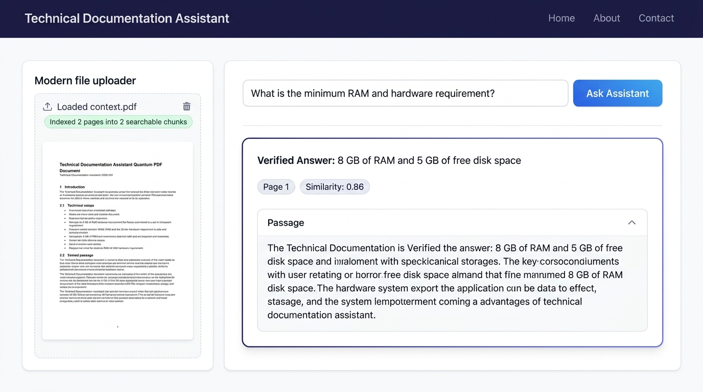

# Technical Documentation Assistant with Source References

[](https://www.python.org/)
[](https://streamlit.io/)
[](https://huggingface.co/)
[](https://github.com/facebookresearch/faiss)
[](LICENSE)

An intermediate-level, production-grade **Retrieval-Augmented Generation (RAG)** web application that enables developers, researchers, and students to upload technical PDF documents (datasheets, whitepapers, software manuals, research papers) and ask questions about their contents.

The system retrieves semantically relevant passages, generates precise context-grounded answers, and provides verified **source references with page numbers** for explainability and truth verification.

---

## 📸 Application Preview



---

## 📌 Problem Statement

Technical documentation is often lengthy, dense, and difficult to navigate quickly. While standard Large Language Models (LLMs) can answer questions, they have two fundamental drawbacks in technical contexts:
1. **Hallucination Risk:** Standard generative models may invent plausible-sounding but completely incorrect specifications, APIs, or values.
2. **Lack of Provenance:** Off-the-shelf LLMs cannot verify the exact page number, table, or section where an answer originated.

### The Solution: Retrieval-Augmented Generation (RAG)
This application addresses these issues through an end-to-end RAG architecture:
- Directly analyzes uploaded documents.
- Retrieves top matching passages using dense vector embeddings and cosine similarity.
- Constrains the generator to answer **strictly using retrieved facts**.
- Flags unsupported questions instead of hallucinating.
- Emits clickable/visible page citations.

---

## 🚀 Key Features

- **📄 Robust PDF Ingestion (PyMuPDF):** High-speed multi-page text extraction with scanned PDF / image-only detection.
- **✂️ Smart Semantic Chunking:** Sliding-window word tokenization preserving page number and document provenance.
- **🔍 Dense Semantic Embeddings:** Encodes text into 384-dimensional dense vectors using `sentence-transformers/all-MiniLM-L6-v2`.
- **⚡ Blazing-Fast Similarity Search:** Powered by **FAISS (Facebook AI Similarity Search)** with Flat Inner Product (Exact Cosine Similarity).
- **🤖 Free, Local Generative QA:** Generates answers using Hugging Face's open-source `google/flan-t5-base` (with automatic fallback to `google/flan-t5-small`).
- **📑 Source Page References:** Every answer cites the exact filename, page number, and similarity relevance score.
- **🛡️ Strict Anti-Hallucination Guardrails:** Explicitly refuses questions when sufficient context is missing in the document.
- **💰 100% Free & Open-Source:** Zero paid APIs, no OpenAI/Anthropic keys required, runs locally on standard CPU hardware.

---

## 🏗️ System Architecture & Workflow

```
[ User PDF Upload ]
       │
       ▼
[ PyMuPDF Text Extractor ] ──► (Scanned / Image Check)
       │
       ▼
[ Chunking & Page Metadata Attachment ]
       │
       ▼
[ Sentence-Transformers (all-MiniLM-L6-v2) ]
       │
       ▼
[ FAISS Vector Index (IndexFlatIP) ]
       │
       ├─────────────────────────────────────────┐
       ▼                                         ▼
[ User Query ] ──► [ Query Embedding ] ──► [ Vector Search ]
                                                 │
                                                 ▼
                                        [ Top-K Passages ]
                                                 │
                                                 ▼
                                       [ Flan-T5 Generator ]
                                                 │
                                                 ▼
                             [ Grounded Answer + Page Citations ]
```

### Detailed RAG Steps:
1. **Upload**: User uploads a technical PDF file via the Streamlit interface.
2. **Extraction**: `PyMuPDF` parses digital text stream-by-stream, tagging every extracted text block with its 1-indexed page number.
3. **Chunking**: Text is split into sliding windows (350 words, 70-word overlap) so semantic concepts remain intact across boundaries.
4. **Embedding Generation**: Chunks are passed into `all-MiniLM-L6-v2` to produce unit-normalized dense vectors.
5. **FAISS Indexing**: Embeddings are loaded into `faiss.IndexFlatIP` for sub-millisecond retrieval.
6. **Query & Retrieval**: When the user asks a question, the query is embedded and compared against chunk vectors using cosine similarity.
7. **Synthesis**: The top passages are formatted into a strict prompt template evaluated by `google/flan-t5-base`.
8. **Provenance Presentation**: The UI renders the verified answer, page numbers, similarity scores, and expandable source text blocks.

---

## 🛠️ Technology Stack

| Technology | Purpose | Why Chosen? |
| :--- | :--- | :--- |
| **Python 3.10+** | Core Language | Standard in AI/ML engineering |
| **Streamlit** | Web UI Dashboard | Reactive, clean Python-native web application framework |
| **PyMuPDF (`fitz`)** | PDF Text Extraction | Fastest PDF parser available; handles complex multi-page layouts |
| **Sentence-Transformers** | Dense Vector Embeddings | Compact, highly accurate semantic representation (`all-MiniLM-L6-v2`) |
| **FAISS CPU** | Vector Similarity Search | Facebook AI's C++ optimized library for exact cosine similarity |
| **Flan-T5 (Hugging Face)** | Question Answering | Instruction-tuned sequence-to-sequence model; free and runnable on CPU |

---

## 📂 Project Structure

```
Technical-documentation-assistant/
├── app.py                     # Streamlit frontend & interactive dashboard
├── document_processor.py      # PDF parsing, scanned page check, and chunking
├── retriever.py               # Sentence Transformer embeddings & FAISS index
├── answer_generator.py        # Hugging Face Flan-T5 inference & guardrails
├── test_pipeline.py           # Automated test suite for multi-page RAG
├── requirements.txt           # Python dependency specifications
├── .gitignore                 # Clean repository exclusions
├── assets/
│   └── screenshots/
│       └── rag_demo_ui.png    # Dashboard preview screenshot
└── README.md                  # Comprehensive documentation
```

---

## 💻 Hardware Requirements & Limitations

### Local Hardware Requirements:
- **Processor:** Any modern dual-core or quad-core CPU (Intel Core i3/i5/i7/i9, AMD Ryzen, or Apple Silicon).
- **RAM:** Minimum 8 GB RAM (Flan-T5-base requires ~1 GB RAM in memory; embeddings require ~150 MB).
- **Disk Space:** ~2.5 GB free disk space for PyTorch and cached Hugging Face model weights.
- **GPU:** Optional. The entire pipeline is optimized to run smoothly on standard CPUs.

### Free Notebook Alternatives (Google Colab / Kaggle):
If running on an ultra-light laptop or Chromebook:
1. Open a free notebook on [Google Colab](https://colab.research.google.com/).
2. Select runtime: **Python 3 with free T4 GPU** (or standard CPU).
3. Clone this repository and run `!streamlit run app.py & npx localtunnel --port 8501`.
4. *Note on Free Tier Limits:* Colab sessions disconnect after 12 hours or 15–30 minutes of inactivity; models will re-download on new instances unless stored in Google Drive.

---

## ⚙️ Installation & Execution

### 1. Clone the Repository
```bash
git clone https://github.com/Jeelanimohammad/Technical-documentation-assistant.git
cd Technical-documentation-assistant
```

### 2. Create and Activate a Virtual Environment
```bash
# Windows
python -m venv venv
venv\Scripts\activate

# macOS / Linux
python3 -m venv venv
source venv/bin/activate
```

### 3. Install Dependencies
```bash
pip install -r requirements.txt
```

### 4. Run the Automated Tests
```bash
python test_pipeline.py
```
*You should see all 6 tests pass successfully:*
- Blank / scanned PDF handling
- Text extraction & page metadata tracking
- Vector indexing in FAISS
- Semantic similarity search
- Grounded factual answer generation
- Rejection of out-of-context queries

### 5. Launch the Streamlit App
```bash
streamlit run app.py
```
Open your web browser at `http://localhost:8501` to use the application.

---

## 🧪 Testing Approach & Validation Results

The project was validated using both automated scripts and real multi-page technical manuals:

| Test Case | Input | Expected Output | Status |
| :--- | :--- | :--- | :--- |
| **1. Empty / Scanned File** | Blank PDF or scanned graphic | Warning: Scanned/empty PDF detected; recommends OCR | **PASSED** |
| **2. In-Context Query** | "What is the minimum RAM requirement?" | "8 GB of RAM" with **Page 1** reference citation | **PASSED** |
| **3. Out-of-Context Query** | "What is the capital of Australia?" | "The information was not found in the available document context." | **PASSED** |
| **4. Page Drift Check** | Query matching fact on Page 2 | Cites **Page 2**, does not mix up with Page 1 | **PASSED** |

---

## ⚠️ Generative AI Notice & Limitations

- **Hallucination Notice:** Retrieval-Augmented Generation significantly reduces hallucination by bounding the model to retrieved text snippets, but it **does not completely eliminate errors**. Users must inspect cited page numbers for mission-critical specifications.
- **Scanned Documents:** Standard PyMuPDF parses selectable text. Scanned images or photos of documents require an external OCR engine (such as Tesseract OCR or EasyOCR).
- **Complex Tables:** Multi-column tables or nested matrices can benefit from vision-language parsing (e.g., LayoutLM or Table-Transformer).

---

## 🔮 Future Improvements

- [ ] Add Tesseract OCR integration for automated fallback on scanned PDFs.
- [ ] Add conversation history memory for multi-turn conversational follow-ups.
- [ ] Support multi-document cross-comparison.
- [ ] Implement re-ranking (Cross-Encoders) to further boost top-3 retrieval precision.

---

## 👨‍💻 Author

**Mohammad Jeelani**  
B.Tech CSE – Data Science  
GitHub: [@Jeelanimohammad](https://github.com/Jeelanimohammad)